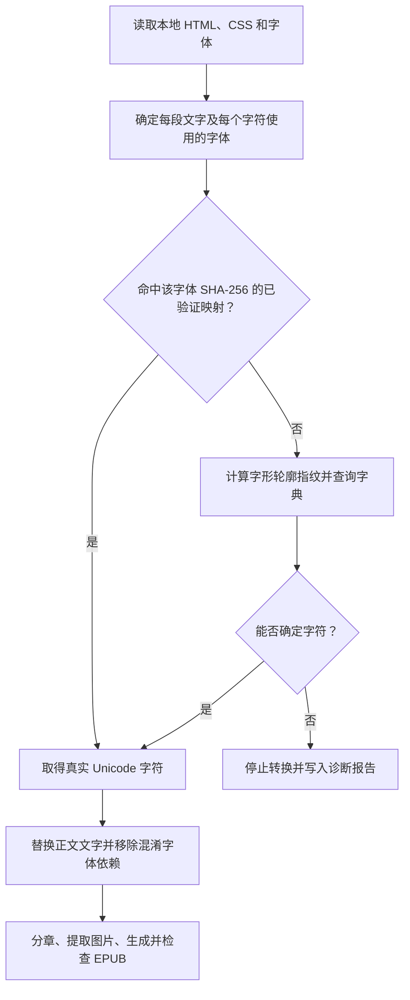

# HTML to EPUB FontFix

将本地 HTML 转换成可重排的 EPUB 3，并还原字体混淆造成的错误汉字，让正文可以正确阅读、复制和搜索。

有些 HTML 在浏览器里看起来正常，复制出来却是另一串汉字。问题可能出在自定义字体：HTML 保存的字符编码与字体实际绘制的字形不一致。普通格式转换会保留这些错误编码。

本项目会先确定文字使用的字体，通过已验证的字符映射和字形轮廓匹配恢复真实 Unicode，再生成 EPUB。提供 Windows 图形界面和命令行，安装依赖后可离线处理资源齐全的本地网页，转换过程不调用 OCR、在线模型或账号服务。

> **适用范围：** 项目附带一组针对样例 HTML 验证过的字体映射，不能保证自动识别任意网页的混淆字体。真实文字模式遇到无法验证的实际用字时会停止，并生成诊断报告。普通、未混淆的 HTML 也可以转换。

## 功能

- 将已验证的混淆字符替换为真实汉字，支持复制、搜索和阅读器换字体。
- 输出 EPUB 3，生成章节导航、NCX 兼容目录、书名页及可识别的封面。
- 提取本地或 data URL 图片，按内容去重；常见兼容格式保留原始数据，其他受支持的图片格式转换为 PNG。
- 支持内嵌字体、本地字体文件、CSS `font-family` 选择器、内联样式及继承。
- 可同时导出文字还原后的 HTML，方便核对正文。
- 生成 JSON 报告，并检查 EPUB 的 ZIP、XML、资源清单、阅读顺序和内部链接。
- 提供 Windows 双击启动、拖放转换、命令行和 Python 调用入口。

## 为什么显示正常，复制却是错字？

一个字符在网页中的显示过程可以简化为：

```text
HTML 中的 Unicode 字符 → 字体 cmap 表 → 字形轮廓 → 屏幕上的字
```

例如，HTML 保存的是 `易`，但自定义字体把这个编码指向了 `漫` 的字形。浏览器显示的是 `漫`，复制时拿到的仍然是 HTML 中的 `易`。

| 环节 | 字符或结果 |
| --- | --- |
| 源 HTML 中保存的文字 | `易长答似词结小后` |
| 原字体绘制出的文字 | `漫长的悼词结束后` |
| 直接提取源文字 | `易长答似词结小后` |
| 本项目还原后的真实文字 | `漫长的悼词结束后` |

同一个源字符在不同混淆字体中可能显示成不同的字，因此替换关系必须结合字体确定，不能对整本书做一张全局替换表。

## 还原原理



### 1. 确定字体作用范围

程序使用 `tinycss2` 解析 CSS、使用 `cssselect2` 匹配选择器，处理支持范围内的优先级、`!important`、内联样式和继承。遇到字体列表时，会结合字体的 `cmap` 判断哪个内嵌字体提供当前字符。

文字节点和行内元素后面的尾部文字分别按所属元素、父元素的字体处理。例如，一段文字中途切换字体时，不会把后面的正文误用前一个行内元素的替换表。

### 2. 优先查询已验证的字体映射

`html_to_epub/data/profiles.json.gz` 保存以下关系：

```text
字体文件的 SHA-256 → 该字体的「源字符 → 真实字符」映射
```

完整字体二进制一致时，才能使用对应映射。字体名称相同、章节名称相同，都不足以复用映射。

当前附带 27 个字体配置，共 18,102 个字符映射条目。这个数量包含不同字体各自的映射，并非 18,102 个互不重复的汉字。

### 3. 对未命中映射的字符匹配字形轮廓

程序通过 FontTools 读取字形，展开复合字形，将轮廓坐标按字体的 `unitsPerEm` 统一尺度，再将绘制操作和控制点序列计算为 SHA-256 指纹。

`html_to_epub/data/glyphs.json.gz` 保存「轮廓指纹 → 正确 Unicode 候选字符」。当前包含 12,168 个轮廓指纹。同一轮廓出现在其他字体子集中时，可以复用这份字典，不依赖字形名称或被修改过的源编码。

这是**精确的轮廓匹配**。字重、版本、曲线类型、绘制顺序或轮廓数据发生变化，都可能导致无法命中；它不提供相似字形猜测。

### 4. 处理歧义并写回真实文字

如果候选中包含当前字符，程序保留当前字符；否则检查候选是否能通过 Unicode NFKC 归一化得到同一个单字符。无法确定的字形会记入 `unresolved_fonts`，真实文字模式停止生成 EPUB。

程序只要求验证页面实际使用、且由对应字体提供的字符。通过验证后，替换的是正文中的 Unicode 字符，再移除输出对混淆字体的依赖，因此复制和搜索也能得到还原后的文字。

### 映射数据从哪里来？

随仓数据基于样例文件预先构建并验证，构建时结合了参考字体轮廓比对、本机离线识别交叉检查，以及分歧字形逐字核对。实际转换只查询映射、匹配轮廓，不运行 OCR。

数据文件保存字符映射和轮廓哈希，不包含原书正文、参考字体文件或完整字形轮廓。新文件出现未知字体时，需要补充可验证的参考数据。

## 快速开始

### 环境要求

- Python 3.10 或更新版本。
- 图形界面需要 Tkinter；Windows 的 Python 官方安装包通常自带。
- 首次安装依赖需要联网。资源已保存在本地或内嵌于 HTML 时，后续转换无需联网。

先下载并解压项目，或克隆仓库，然后进入包含 `convert.py` 的项目目录：

```bash
git clone https://github.com/HMBlankcat/HTML-to-EPUB-FontFix.git
cd HTML-to-EPUB-FontFix
```

### Windows 图形界面

1. 双击 `start.cmd`。首次启动会在项目内创建 `.venv` 并安装依赖。
2. 选择输入 HTML 和 EPUB 保存位置。
3. 保持默认的「真实文字：支持正确复制与搜索」模式。
4. 按需保留「同时保存还原文字后的 HTML」，点击「开始转换」。

也可以把一个 HTML 文件拖到 `start.cmd` 上，直接在输入文件旁生成同名 EPUB。拖放方式默认不额外导出还原 HTML。

### 命令行

在项目目录安装依赖：

```bash
python -m pip install -r requirements.txt
```

转换一个 HTML，在原文件旁生成同名 EPUB：

```bash
python convert.py "示例.html"
```

指定输出位置，同时导出真实文字 HTML：

```bash
python convert.py "示例.html" -o "output/示例.epub" --restored-html "output/示例.restored.html"
```

指定书籍信息：

```bash
python convert.py "示例.html" -o "output/示例.epub" --title "示例书籍" --author "示例作者" --language "zh-CN"
```

打开图形界面或查看帮助：

```bash
python convert.py --gui
python convert.py --help
```

也支持在项目目录安装为命令：

```bash
python -m pip install .
html-to-epub "示例.html" -o "output/示例.epub"
```

macOS / Linux 可按环境将 `python` 换成 `python3`；图形界面还需系统提供 Tkinter。当前文件验证在 Windows 上完成，其他系统尚未专门验证。

## 命令行参数

| 参数 | 说明 |
| --- | --- |
| `input` | 输入 HTML 路径；省略时打开图形界面 |
| `-o`, `--output` | 输出 EPUB 路径；默认与输入文件同目录、同名 |
| `--mode text` | 默认模式，写入经过验证的真实文字 |
| `--mode visual` | 保留源字符编码并嵌入字体，复制和搜索仍可能是错字 |
| `--restored-html PATH` | 额外导出文字还原后的 HTML，配合 `text` 模式使用 |
| `--reference-font PATH` | 为本次转换补充正确参考字体，可重复指定 |
| `--title TEXT` | 指定书名；默认读取 HTML 的 `<title>`，否则使用文件名 |
| `--author TEXT` | 指定作者；未指定时尝试从 `.meta-info` 中读取作者字段 |
| `--language CODE` | 指定语言；默认读取 HTML 根元素的 `lang`，否则为 `zh-CN` |
| `--allow-remote` | 允许读取网页引用的远程样式、字体及图片资源 |
| `--force` | 允许覆盖指定的 EPUB 和还原 HTML 输出 |
| `--gui` | 打开图形界面 |

默认不修改源 HTML，也不覆盖已有 EPUB 或还原 HTML。图形界面发现已有输出时会询问是否覆盖。

### 两种转换模式

| 项目 | `text`，真实文字，默认 | `visual`，保留字体 |
| --- | --- | --- |
| 正文编码 | 替换为验证后的真实 Unicode | 保留源字符编码 |
| 字体 | 输出无需原混淆字体 | 将字体转换为 OTF/TTF 后嵌入 EPUB |
| 复制、搜索 | 使用还原后的文字 | 混淆正文仍可能返回错字 |
| 未知字形 | 停止并生成报告 | 不做字形还原，显示效果依赖阅读器的字体支持 |

需要复制、搜索时，请使用默认的 `text` 模式。`visual` 适用于仅需保留字体显示的场景，也仍受当前 CSS 解析范围限制。

## 输出文件与报告

例如执行：

```bash
python convert.py "示例.html" -o "output/示例.epub" --restored-html "output/示例.restored.html"
```

会得到：

```text
output/
├── 示例.epub            # 可重排电子书
├── 示例.report.json     # 转换统计与诊断报告
└── 示例.restored.html   # 可选的真实文字 HTML
```

报告包含 `status`、`mode`、章节数、图片数、替换字符次数、字体 SHA-256、字体实际用字数及 EPUB 检查结果。`replaced_characters` 统计替换发生的次数，同一个字多次出现会重复计数。

未知字形报告的结构示例：

```json
{
  "status": "failed",
  "mode": "text",
  "unresolved_fonts": [
    {
      "font": "example-font",
      "sha256": "字体文件的 SHA-256",
      "unresolved": "待验证的源字符"
    }
  ]
}
```

`unresolved` 是 HTML 原本保存的字符，未必是屏幕上显示的字。字体验证失败时不会写出新的 EPUB；已有 EPUB 不会因为这次字体验证失败而被删除。

报告会在字体解析、还原和打包阶段记录成功或失败。输入不存在、输出冲突等前置检查失败时，可能尚未生成报告。

还原 HTML 保留原页面的资源引用方式：内嵌图片仍可离线查看；相对路径图片若要随 HTML 移动，需要一起保留资源目录。EPUB 会将其使用的图片打包进书内。

## 支持的 HTML 结构与限制

### 章节、封面与版式

- 有 `.chapter` 容器时，按这些容器生成章节；建议使用互不嵌套的章节容器。
- 每章第一个 `h1`、`h2` 或 `h3` 用作目录标题。
- 没有 `.chapter` 时，将正文整体保存为一个条目，不会自动按所有标题分章。
- 分章结构中的 `.cover-img` 容器可用于提取封面图片。
- EPUB 使用适合阅读的基础样式，不保证逐像素复刻网页布局。

最小分章结构示例：

```html
<!DOCTYPE html>
<html lang="zh-CN">
<head>
  <meta charset="utf-8">
  <title>示例书籍</title>
</head>
<body>
  <div class="meta-info">作者：示例作者</div>
  <div class="cover-img"></div>
  <section class="chapter" id="chapter-1">
    <h2>第一章</h2>
    <p>第一章正文。</p>
  </section>
  <section class="chapter" id="chapter-2">
    <h2>第二章</h2>
    <p>第二章正文。</p>
  </section>
</body>
</html>
```

有 `.chapter` 时，章外普通内容不会自动并入正文；需要保留的前言、后记等也应放入章节容器。

### 字体与网页特性

当前支持静态 HTML 和已保存的字体资源。以下情况不属于可靠的自动还原范围：

- 字体简写 `font:` 与内嵌字体混用；请先展开为 `font-family`。
- 同一字体族包含多个不同字重或样式文件。
- 依赖视口、复杂条件或完整浏览器环境才能确定的字体规则。
- 系统字体排在混淆字体前，导致实际使用哪个字形无法确定。
- 字体缺失、未知轮廓、无法消除的字符歧义。
- 依赖 JavaScript 动态生成的正文、Canvas 文字、扫描图片中的文字。

程序不会执行网页脚本。动态页面需要先导出包含实际正文和确定样式的静态 HTML。对于静态 CSS，也不能将本项目视为完整浏览器渲染引擎。

### 本地与远程资源

默认读取本地文件和 data URL。若出现「资源尚未保存在本地」，可以先保存完整网页及资源目录，或显式允许联网读取：

```bash
python convert.py "示例.html" --allow-remote
```

需要登录、Cookie、浏览器执行或复杂资源路径的网页，建议先另存完整静态页面；此参数不提供浏览器抓取功能。

## 扩展字形字典

当新文件出现未知字形时，可以提供**编码正确、且轮廓与目标字体一致的参考字体**。参考字体中某个 Unicode 对应的字形必须确实是那个字。

仅为本次转换添加参考字体：

```bash
python convert.py "示例.html" --reference-font "fonts/reference.otf"
```

多个参考字体：

```bash
python convert.py "示例.html" --reference-font "fonts/reference-a.otf" --reference-font "fonts/reference-b.ttf"
```

将参考字体的轮廓指纹合并写入当前源码目录的字典：

```bash
python tools/build_dictionary.py "fonts/reference.otf"
```

此脚本更新 `html_to_epub/data/glyphs.json.gz`，不保存参考字体文件，也不自动创建按字体 SHA-256 绑定的 `profiles.json.gz` 配置。若使用 `pip install .` 安装的命令，修改源码字典后需重新安装，才会更新已安装的副本。

**随便找一款能显示中文的字体，通常不能完成还原。** 字形外观相似但轮廓数据不同，也无法精确匹配。不要把仍有错误编码的混淆字体作为「正确参考字体」。

## 已验证结果

在一份约 29 MB、包含 27 个混淆字体的样例 HTML 上，已完成以下验证：

| 项目 | 结果 |
| --- | --- |
| 章节条目 | 249 个 |
| 字符替换次数 | 61,404 次 |
| 图片 | 27 张，输出与输入逐字节一致 |
| 文字一致性 | 249 个 EPUB 正文条目与还原 HTML 的对应章节一致 |
| 未混淆部分 | 原有前 220 个条目的文字保持一致 |
| EPUB 内部检查 | ZIP CRC、XML、manifest、spine、内部链接及锚点通过 |
| 回归测试 | 6 项通过 |

这些数字是样例文件的验证结果，不代表对其他任意字体的识别率。验证细节见 [VALIDATION.md](VALIDATION.md)。

内置检查用于发现常见打包错误，不能替代完整 EPUBCheck；当前未提供 EPUBCheck 通过认证或所有阅读器的兼容性保证。

## 常见问题

### 能保证所有 HTML 都还原正确吗？

不能。字体混淆没有统一格式，本项目依赖可验证的映射或精确轮廓。对支持范围内的字体，程序验证实际用字后才输出真实文字；未知情况需要补充参考数据或扩展解析逻辑。

### 出现「字形尚未验证」怎么办？

打开输出 EPUB 同名的 `.report.json`，查看 `unresolved_fonts`。确认字体资源完整后，可以尝试添加正确参考字体。仅需阅读时可以尝试 `--mode visual`，但它不能解决错误编码造成的复制、搜索问题。

### 可以把一整个网站下载下来吗？

当前入口处理单个本地 HTML，不提供站点爬取、登录、批量抓取或章节下载功能。

### 为什么没有生成多章目录？

自动分章依据 `.chapter` 容器。普通网页只有标题而没有这些容器时，会保存为一个正文条目；可先整理 HTML 结构。

### Windows 提示没有 Python，或启动安装失败？

安装 Python 3.10+ 并确认终端可以运行 `python --version`，然后重新打开 `start.cmd`。依赖安装失败时，可以在项目目录按上面的命令行步骤操作，查看完整报错。

### 会修改原文件或上传正文吗？

程序禁止输出覆盖源 HTML。转换不向 OCR 或模型服务上传正文；默认只读取本地资源。使用 `--allow-remote` 时会向网页引用的远程资源地址发出下载请求。

## 项目结构

```text
html-to-epub/
├── convert.py                 # 命令行与图形界面入口
├── start.cmd                  # Windows 启动与依赖安装
├── pyproject.toml             # 包配置与命令入口
├── requirements.txt           # 运行依赖
├── README.md
├── VALIDATION.md              # 样例验证记录
├── html_to_epub/
│   ├── cli.py                 # 命令行参数
│   ├── gui.py                 # Tkinter 图形界面
│   ├── fonts.py               # 字体作用范围、轮廓指纹及文字还原
│   ├── converter.py           # 分章、图片、EPUB 打包与检查
│   └── data/
│       ├── profiles.json.gz   # 按字体 SHA-256 绑定的字符映射
│       └── glyphs.json.gz     # 轮廓指纹与正确字符候选
├── tools/
│   └── build_dictionary.py    # 从正确参考字体扩展轮廓字典
└── tests/
    └── test_conversion.py     # 回归测试
```

### Python 调用

在项目目录，或安装本项目后运行：

```python
from html_to_epub.converter import convert

report = convert(
    "示例.html",
    "output/示例.epub",
    mode="text",
    restored_html="output/示例.restored.html",
)
print(report["replaced_characters"])
```

### 开发与测试

```bash
python -m pip install -r requirements.txt
python -m pip install pytest
python -m pytest -q
```

测试覆盖字体还原、CSS 作用范围、行内元素尾部文字、未知字体中止、图片与封面、大体积内嵌属性、输出编码以及覆盖保护等行为。

### 发布到 GitHub

上传本项目目录中的源码、文档、测试和 `data/*.json.gz` 即可。两个数据文件是默认还原功能的组成部分，请保留在仓库中。`.venv`、构建缓存和 Python 缓存已在 `.gitignore` 中排除。

待转换 HTML、输出 EPUB、诊断报告及完整参考字体无需随项目发布。示例命令使用通用文件名；如分享真实诊断报告，请先处理其中的本地路径信息。

## 许可证

本项目采用 [Apache License 2.0](LICENSE)。
